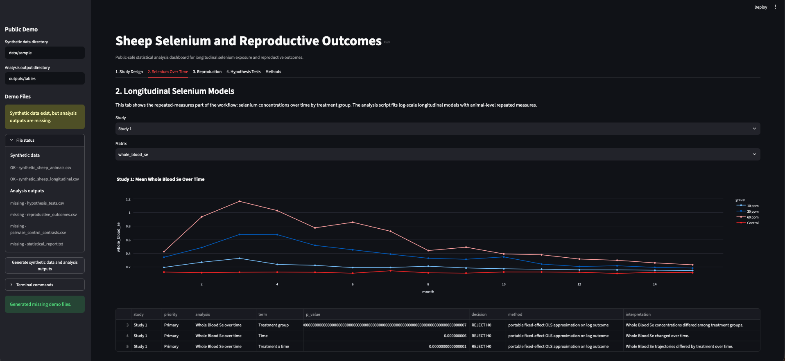

# Sheep Selenium Reproductive Statistics

Public-safe statistical analysis project for a sheep selenium supplementation and
reproductive-efficiency study.

This repository is designed as a data-science portfolio artifact. It shows how to move from
a manuscript-style R analysis into a reproducible public workflow with synthetic data,
statistical test tables, a dashboard, and explicit study-design caveats.



The public data are synthetic. They mimic the structure of the original study but are not
biological evidence.

Start with [`CASE_STUDY.md`](CASE_STUDY.md) for the employer-facing walkthrough.

## What This Shows

- Longitudinal selenium analysis with repeated measurements by animal.
- Reproductive outcome summaries for repeat breeding and final pregnancy.
- Primary global treatment tests plus secondary control-vs-treatment contrasts.
- Baseline-weight checks as a potential confounding assessment.
- A clear limitation section for small samples and one-pen-per-treatment designs.
- A Streamlit dashboard that lets reviewers inspect design, trajectories, outcomes, and
  p-value tables.

## Run the Public Demo

```bash
pip install -e .
python scripts/generate_synthetic_sheep_data.py
python scripts/analyze_sheep_stats.py
streamlit run dashboard/app.py
```

The scripts create:

```text
data/sample/synthetic_sheep_animals.csv
data/sample/synthetic_sheep_longitudinal.csv
outputs/tables/hypothesis_tests.csv
outputs/tables/reproductive_outcomes.csv
outputs/tables/pairwise_control_contrasts.csv
outputs/tables/statistical_report.txt
```

## Dashboard Flow

The dashboard is organized as:

1. **Study Design**: treatment groups, pens, animal counts, and the pen-confounding caveat.
2. **Selenium Over Time**: longitudinal whole-blood and liver selenium trajectories.
3. **Reproduction**: pregnancy and repeat-breeding summaries.
4. **Hypothesis Tests**: p-value table with decisions and methods.
5. **Methods**: interpretation rules and public-safe boundaries.

## Original Analysis Context

The supplied archive included one main R Markdown analysis file and final result tables:

- `Sheep_4.0_Analysis_UPDATED_v2.Rmd`
- `Results/Final_Statistical_Report.txt`
- reproductive outcome tables;
- pairwise control-contrast tables;
- final hypothesis-test table;
- Study 2 cohort quality-control table.

The source R Markdown is preserved in public-safe form under:

`research_archive/original_analysis_code/`

The original R workflow used repeated-measures modeling through R statistical packages. The
public Python demo intentionally uses a portable `numpy`/`scipy` approximation on synthetic
data so the project can run cleanly without collaborator files.

## Important Design Limitation

If each treatment group is housed in one pen, treatment and pen are confounded. In that
case, treatment-group differences are still describable, but the analysis cannot fully
separate selenium dose effects from pen-level conditions.

This is not a reason to hide the study. It is exactly the kind of limitation a serious data
scientist should identify, document, and carry into interpretation.

## Public-Safe Boundary

This repository excludes collaborator raw files and uses synthetic data for the runnable
workflow. The result summaries describe the structure of the original analysis, but the
dashboard and regenerated outputs are public-demo artifacts.
